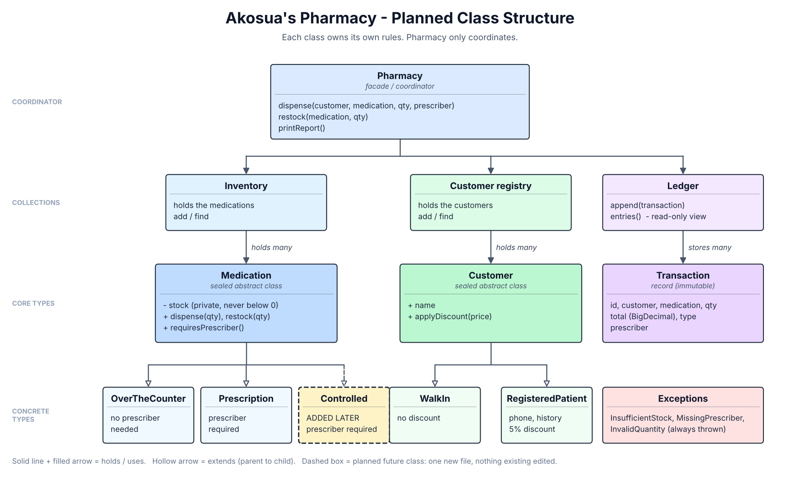

# DIAGNOSIS.md: Akosua's Pharmacy Tracker

## Summary

The program works on the happy path, but its structure makes it easy to break and impossible to trust. The root causes are (1) every object exposes its internal state publicly, so nothing can protect an invariant, and (2) the rules for each kind of medicine and customer are written as string comparisons inside one big method, so every new rule means editing code that already works.

Problems are ranked below by danger to *this* business, a pharmacy where a wrong stock count is a safety issue.

---

## 1. Stock can go negative (MOST DANGEROUS)

**What is wrong.** `dispense` never checks that `qty <= m.stock` before doing `m.stock = m.stock - qty`. The demo in `main` shows it: dispensing 100 x Amoxicillin when 39 are left drives stock to -61, and the transaction is still recorded as a successful dispense.

**Root cause.** Two things combine: there is no validation in the dispense logic, and `Medication.stock` is a `public int`, so *any* code anywhere can set it to any value. Even if I added a check in `dispense`, the next person could bypass it with `m.stock = -5`.

**Business risk.** The pharmacy's records claim it dispensed medicine it never had. Staff may promise or hand over drugs that do not exist, reorder decisions are made on false numbers, and the transaction log and the shelf disagree. This is exactly what Akosua said she can no longer trust. It is the one rule that must never be broken, so it is the top priority.

---

## 2. Public mutable fields everywhere (the enabler of #1)

**What is wrong.** `Medication`, `Customer`, `Pharmacy.meds`, `Pharmacy.customers` and `Customer.history` are all `public` and mutable. Price, category, stock, name, kind and id can all be changed from outside at any time. `Pharmacy.getTransactions()` also returns the *live internal list* (it is never copied), so a caller can delete or alter the audit trail. The same is true of `meds`, `customers` and `Customer.history`: they are public lists that anyone can add to or clear.

**Root cause.** No encapsulation. Objects are bags of data rather than owners of their own rules. The constructors validate nothing either: `new Medication("x", -5, -10, "typo")` is accepted (negative price, negative starting stock, bad category), so an invalid object can be created in the first place, not only corrupted later. `id` and `name` are not `final`, so identity can change after creation.

**Business risk.** Any invariant (stock >= 0, price > 0, a valid category) is only a convention. A single careless line elsewhere silently corrupts data, and nothing flags it. The exposed transaction list means the audit trail can be rewritten, which matters for a pharmacy that must be able to account for what it dispensed.

---

## 3. Behaviour chosen by string comparison inside one method

**What is wrong.** `category` is a `String` ("OTC" / "PRESCRIPTION") and `kind` is a `String` ("WALK_IN" / "REGISTERED"). `dispense` branches on them with `.equals(...)`. The OTC and PRESCRIPTION branches are near-duplicates (price, discount, stock update, history, transaction).

**Root cause.** Types are encoded as text instead of being modelled as types. (An `enum` would at least remove the typo risk, but behaviour would still live in `switch` branches. I prefer sealed classes so each kind owns its own rule; see the design notes.) The differences between medicine kinds live in `if/else` branches rather than in the kinds themselves.

**Business risk.**
- **Typos fail silently.** `"Prescription"` or `"otc"` matches neither branch. The method then skips the stock update and the early return, but still adds to history and logs a transaction with total 0. No error is raised.
- **Adding controlled substances is dangerous.** A third category means a third copy of the branch plus a new prescriber rule. This is the very pattern that caused the past "changing one medicine broke another" incidents Akosua describes.

---

## 4. Duplicated discount and pricing logic

**What is wrong.** The "registered patients get 5% off" rule is copy-pasted in both branches, with the magic number `0.95`.

**Root cause.** Customer-kind behaviour is not owned by the customer type, and there is no single place for pricing.

**Business risk.** If the discount changes, or a branch is edited and the other is forgotten, two kinds of medicine will charge differently by accident, which is a wrong-money bug.

---

## 5. Prescription rule is weak and not reusable

**What is wrong.** The prescriber check is only `prescriber == null`. An empty string or blank spaces ("") is accepted as a valid prescriber. Also, the prescriber is only printed to the console; it is **not stored** in the `Transaction`.

**Root cause.** Validation is ad hoc, and `Transaction` has no field for the prescriber.

**Business risk.** The pharmacy cannot later show *who* prescribed a dispensed medicine. For controlled substances, where recording the prescriber is mandatory, this gap is a compliance problem waiting to happen.

---

## 6. Silent failure instead of clear errors

**What is wrong.** Failures are handled by `System.out.println` and `return`, and there is `qty` is never validated in `dispense` or `restock`: a negative or zero `qty` is accepted (a negative dispense would *increase* stock and produce a negative total). `restock` has the same gap: a negative quantity lowers stock. A null customer or medication in `dispense` or `restock` crashes with a raw `NullPointerException` instead of a clear message. The caller cannot tell success from failure.

**Root cause.** No error-handling strategy; business logic is mixed with console output.

**Business risk.** A rejected dispense looks the same as a successful one to calling code, and bad inputs quietly corrupt stock and totals.

---

## 7. Money stored as `double`

**What is wrong.** Prices and totals use `double`, so `12.50 * 2 * 0.95` and similar calculations carry floating-point error.

**Root cause.** Wrong type for currency.

**Business risk.** Small rounding errors in totals, and inconsistent sums across a day. Lower urgency than stock, but it undermines trust in the numbers.

---

## 8. Global static ID counters and string-typed records

**What is wrong.** IDs come from non-thread-safe `static int counter` fields in three classes, mutated in constructors. `Transaction` stores `customerName` and `medName` as copied strings and `type` as a string.

**Root cause.** Hidden global state, and records that reference people and medicines by text rather than by identity. `Transaction` is a plain class with public mutable fields, even though it is a fixed historical record and the textbook case for a Java `record` (immutable, with equals/toString for free). As written, any caller can edit a past transaction.

**Business risk.** Duplicate IDs if used concurrently, and a rename of a medicine or customer leaves history pointing to the old name. Lower priority for a single-user tool, but it hurts testability.

---

## 9. Smaller structural issues

- **Unclear names.** Parameters such as `c`, `m`, `p` and `qty` hide meaning; the next person has to decode them. Clear names (`customer`, `medication`, `pharmacy`, `quantity`) matter because the brief says the code must be understandable by whoever inherits it.
- One file holds everything and `Pharmacy` mixes inventory, customers, pricing, rules, logging and reporting (too many responsibilities).
- **Everything is in the default package** with no package structure, and all classes share one file, so nothing is separated by responsibility (model, rules, ledger, errors).
- **Composition over flags.** `Customer` uses a `kind` string flag instead of separate types, so `phone` and `history` exist on walk-ins where they make no sense. Splitting into `WalkInCustomer` and `RegisteredPatient` removes the flag, and the discount can then belong to the type that earns it.
- No tests exist, so there is no way to prove a refactor preserves behaviour.
- Duplicate medications or customers can be added without any check.

---

## Most dangerous problem

**#1, negative stock, made possible by #2, public mutable state.** In a pharmacy a wrong count is a safety issue, and it is the one rule the business said must never be broken. The fix has to be structural (the stock owns its own rule and cannot be set to an invalid value from outside), not just an `if` in one method.

---

## Planned structure (sketch)

```
Pharmacy  (facade / coordinator)
 ├── Inventory  ── holds ──> Medication (abstract / sealed)
 │                              ├── OverTheCounterMedication
 │                              ├── PrescriptionMedication     (requires prescriber)
 │                              └── ControlledMedication  <- added later (requires prescriber)
 │                           Medication owns a private StockLevel/stock;
 │                           only dispense(qty) / restock(qty) can change it
 ├── Customer (sealed): WalkInCustomer | RegisteredPatient (phone, history, 5% discount)
 ├── Transaction (record): id, customer, medication, qty, total (BigDecimal), type, prescriber
 └── Ledger: stores transactions, exposes an unmodifiable view only

Errors: InsufficientStockException, MissingPrescriberException (checked/unchecked, clear messages)
```

**Why this shape.** Each medicine type owns its own dispensing rule, and each customer type owns its own discount. `Pharmacy.dispense` stops branching on strings, so adding a controlled-substance class means adding one new class and no edits to existing, working ones.



*The diagram above (`design-sketch.png`) shows the same structure. The dashed box is the controlled-substance class Akosua plans to add: one new class, with no existing class edited.*
