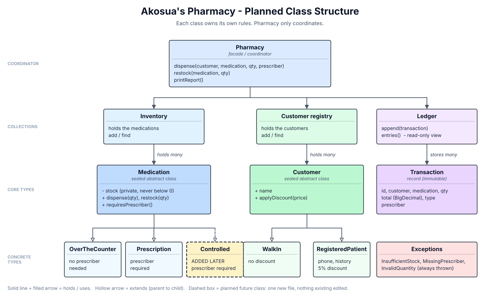

# Akosua's Pharmacy - Stock and Dispensing Tracker

A Java application for managing pharmacy medication inventory, dispensing, restocking, customers and transaction records.

This is the rebuilt version of the *Java Basics Lab A - Akosua's Pharmacy* starter repository. It keeps the original business behaviour, enforces the rule that a stock count can never go below zero, and is organised so new kinds of medication can be added safely.

## Features

- **Medication management:** over-the-counter and prescription medications.
- **Customer management:** walk-in customers and registered patients.
- **Stock control:** dispensing more than is in stock is refused, and stock never goes negative.
- **Prescription validation:** a prescriber is required for prescription medication and is recorded on the transaction.
- **Restocking:** stock can be replenished.
- **Transaction ledger:** every dispense and restock is recorded and cannot be altered.
- **Customer history:** read from the ledger, so there is one source of truth.
- **Patient discounts:** registered patients get 5% off.
- **Low-stock alerts:** medications at or below their reorder level are listed.

## Requirements

- JDK 21
- Apache Maven 3.9 or later (optional; see "Without Maven" below)

## Getting started

```bash
git clone https://github.com/suleiman-baba-mohammed/java-basics-a-akosuas-pharmacy.git
cd java-basics-a-akosuas-pharmacy
```

### With Maven

```bash
mvn clean compile
java -cp target/classes com.akosua.pharmacy.Main
```

Run the tests:

```bash
mvn test
```

### Without Maven (JDK only)

Linux / macOS:

```bash
mkdir -p target/classes
javac -d target/classes $(find src/main/java -name "*.java")
java -cp target/classes com.akosua.pharmacy.Main
```

Windows (PowerShell):

```powershell
New-Item -ItemType Directory -Force target/classes | Out-Null
$files = Get-ChildItem -Path src/main/java -Recurse -Filter *.java | ForEach-Object { $_.FullName }
javac -d target/classes $files
java -cp target/classes com.akosua.pharmacy.Main
```

Running the tests without Maven needs the JUnit 4.13.2 and Hamcrest 1.3 jars, which Maven normally downloads for you.

## Expected output

```text
Dispensed 2 x Paracetamol 500mg to Kofi Mensah for GHS 25.00
Dispensed 1 x Amoxicillin 250mg to Ama Owusu (prescribed by Dr. Boateng) for GHS 28.50
Restocked 50 x Paracetamol 500mg
Dispense rejected: Insufficient stock for Amoxicillin 250mg: requested 100, available 39

=== Akosua's Pharmacy - end of day ===
Stock levels:
  Paracetamol 500mg (OTC): 148 in stock
  Amoxicillin 250mg (PRESCRIPTION): 39 in stock
Transactions today: 3

=== Low-stock alerts ===
LOW STOCK: Amoxicillin 250mg - 39 remaining (reorder level: 40)
```

The refusal is also logged as a warning on the error stream.

## Project structure

```text
src/main/java/com/akosua/pharmacy/
├── Main.java
├── model/
│   ├── Medication.java
│   ├── OverTheCounterMedication.java
│   ├── PrescriptionMedication.java
│   ├── Customer.java
│   ├── WalkInCustomer.java
│   ├── RegisteredPatient.java
│   ├── Transaction.java
│   └── TransactionType.java
├── inventory/
│   └── Inventory.java
├── ledger/
│   └── Ledger.java
├── service/
│   └── Pharmacy.java
└── exceptions/
    ├── InsufficientStockException.java
    └── MissingPrescriberException.java
src/test/java/com/akosua/pharmacy/
└── PharmacyTest.java
```

## Business rules

1. Medication stock cannot become negative.
2. Dispensing and restocking quantities must be positive.
3. Prescription medication cannot be dispensed without a prescriber name.
4. Only registered patients receive the 5% discount.
5. Medication prices must be positive.
6. Low-stock alerts appear when stock reaches or falls below a medication's reorder level.

## Design documentation

- [DIAGNOSIS.md](DIAGNOSIS.md): problems found in the original application.
- [DESIGN_NOTES.md](DESIGN_NOTES.md): the rebuilt architecture, design decisions, differences from the original output, and limitations.

The structure was sketched before any code was written:



## Testing

`PharmacyTest` has 24 JUnit tests. Each test builds its own pharmacy, so they do not depend on each other. They cover dispensing, discounts, rounding, restocking, the stock rule, prescriber validation, ledger protection, history, low-stock alerts, and the demo program's output.

## Future extension

Controlled substances are one new class, with no change to `Pharmacy`, `Inventory` or `Ledger`:

```java
public class ControlledMedication extends Medication {

    public ControlledMedication(String name, BigDecimal price, int initialStock, int reorderLevel) {
        super(name, price, initialStock, reorderLevel);
    }

    @Override
    public String getCategory() {
        return "CONTROLLED";
    }

    @Override
    public boolean requiresPrescriber() {
        return true;
    }
}
```

A test in `PharmacyTest` defines exactly this class and checks that it is refused without a prescriber, records the prescriber, and cannot go below zero.
